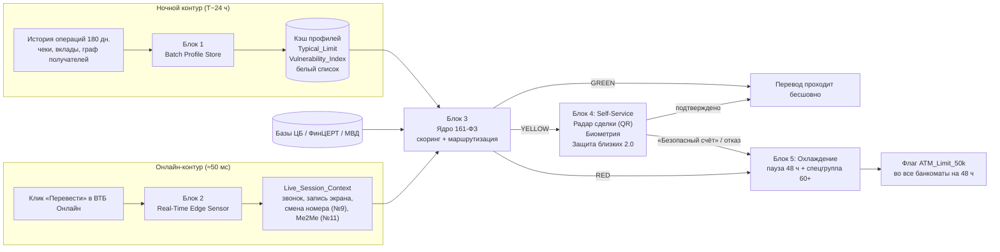

# Архитектура «ВТБ Контекст 360»

Главная идея: тяжёлые данные приходят с лагом до 24 часов, а решение по переводу нужно за доли секунды. Поэтому риск считается в два контура: ночной профиль готовится заранее, а онлайн-сенсор снимает только то, что видно в момент клика. Ядро склеивает их и выбирает коридор «Светофора».

## Где это в коде

| Блок решения | Модуль | Что делает |
| --- | --- | --- |
| 1. Batch Profile Store | `models.ClientProfile` | Ночной вектор: `typical_limit`, `vulnerability_index`, `whitelist` |
| 2. Real-Time Edge Sensor | `models.SessionContext` | Слепок сессии: звонок, демонстрация экрана, признаки №9 и №11, новое устройство |
| 3. Ядро 161-ФЗ | `engine.Context360Engine.score` и `route` | Жёсткие стопы, баллы риска, сетевые признаки дропа, коридор |
| 4. Радар сделки и Защита близких 2.0 | `engine.Context360Engine.self_service` | Снятие подозрения самим клиентом без звонка в КЦ |
| 5. Охлаждение и реабилитация | `engine.Context360Engine.decide` и `atm_limit` | Пауза 48 ч и синхронный лимит 50 000 ₽ в банкоматах |
| «Как сейчас» | `engine.LegacyRules` | Любой признак = блок ДБО и звонок в КЦ, банкоматы ничего не знают |

## Логика скоринга

Жёсткие стопы, сразу RED:

- получатель в базе ЦБ / ФинЦЕРТ;
- демонстрация экрана или удалённый доступ;
- активный звонок + новый получатель + сумма ≥ max(50% Typical_Limit, 30 000 ₽) — перевод под диктовку.

Баллы риска:

| Сигнал | Баллы |
| --- | --- |
| Новый получатель (нет в белом списке) | +20 |
| Сумма > 1,5× / > 3× типичной | +15 / +25 |
| Признак №9: смена номера ≤ 48 ч | +25 |
| Признак №11: Me2Me ≥ 200 тыс. ₽ за 24 ч и новый получатель | +30 |
| Новое устройство | +15 |
| Счёт получателя моложе 30 дней | +15 |
| ≥ 5 разных отправителей за 24 ч у получателя | +25 |
| Vulnerability_Index ≥ 7 | ×1,2 |

Коридоры: `score < 35` → GREEN, `35–70` → YELLOW, `> 70` → RED. Все пороги лежат в `config.Thresholds` и калибруются на пилоте.
